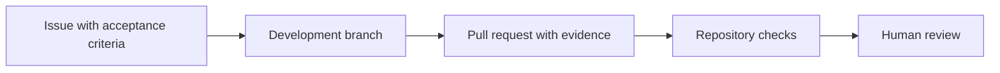

# Contributing

## Local development

Follow [Getting started](README.md#getting-started). CI uses mise 2026.11.7.
The tool lock covers Linux x64 and macOS arm64. With mise activated in your
shell, you can omit `mise exec --` from these commands.

| Command                    | Purpose                                                                                    |
| -------------------------- | ------------------------------------------------------------------------------------------ |
| `mise exec -- pnpm format` | Apply Biome formatting. Review the diff before staging.                                    |
| `mise exec -- pnpm lint`   | Run Biome, markdownlint-cli2, actionlint, and offline zizmor audits.                       |
| `mise exec -- pnpm test`   | Run the Node test suite, including the frontmatter and Mermaid regression test.            |
| `mise exec -- pnpm check`  | Verify formatting, lint, local links and anchors, staged and committed secrets, and tests. |

During development, run `pnpm lint` for fast feedback and `pnpm test` when
changing behavior. Before publishing, stage new files and run `pnpm check` so
Gitleaks sees staged content and committed history. Repeat after amending a
commit. Every PR runs the same gate on Linux under **Repository checks**.
Aim for five seconds locally and sixty seconds of runner time.

For a toolchain update or an external reference change, run `pnpm check`
and `pnpm check:online` on demand. **Actions → Quality → Run workflow** runs
both on macOS arm64. Online validation checks external links and runs the
registry dependency audit, failing on high or critical advisories. Local mise
and pnpm reuse their stores. In the first two Linux runs, tool and dependency
setup took 3–5 seconds combined. Revisit remote caches if setup becomes a
bottleneck. [Timing measurements](https://github.com/niikei/agentic-pm/issues/1#issuecomment-7198966797).

Pin tools in `mise.toml` and regenerate `mise.lock` with `mise lock`. Pin
JavaScript dependencies in `package.json` and refresh `pnpm-lock.yaml` with
`mise exec -- pnpm install`. When upgrading pnpm, update both version pins.
Review lockfile changes and run the frozen install and checks before submitting.

## TypeScript

When a feature needs TypeScript, use mise's Node.js 26 and pnpm, set
`"type": "module"`, and execute erasable TypeScript directly with Node. Use
Biome and prefer `node:test` for lightweight tests. Run the pinned official
`tsc --noEmit` as a separate check. Keep source comments and JSDoc in English.

Set `module` and `moduleResolution` to `NodeNext`. Enable `strict`,
`noUncheckedIndexedAccess`, `exactOptionalPropertyTypes`,
`verbatimModuleSyntax`, and `erasableSyntaxOnly`. For a no-emit project,
enable `allowImportingTsExtensions` and use explicit extensions for relative
imports. Use `import type` for type-only bindings.

Use Node's `package.json#imports` for internal modules. For example,
`"imports": { "#/*": "./src/*.ts" }` resolves `#/model` to `src/model.ts`
in both Node and the type checker. Avoid `tsconfig.paths` and deep relative
imports. Consider tsdown when a deliverable requires bundled JavaScript.

The tsrs beta was faster on a synthetic fixture. Keep the official compiler
as the correctness baseline and revisit tsrs when measurements on real
project code justify a second checker. See the [compiler evaluation](https://github.com/niikei/agentic-pm/issues/4).

## Formatting and diagrams

Biome 2.6.9 formats GitHub Flavored Markdown, YAML, JSON, and JavaScript.
Enable its frontmatter parser so formatting preserves agent metadata. Biome
formats Issue Forms and workflows as YAML and preserves the contents of Mermaid
fences. This coverage allows the repository to use one formatter.
See [Biome language support](https://biomejs.dev/introduction/language-support/).

Use one H1, unique headings, and consecutive heading levels in each Markdown
document. markdownlint-cli2 checks these conventions and Lychee checks local
heading links across files. Install the recommended VS Code extensions to use
the workspace formatter on save. Use Mermaid for small embedded diagrams and
D2 source for complex architecture diagrams. Preview diagram changes when
reviewing their meaning.

## Drafting an issue with Copilot

In [Copilot Chat on GitHub](https://github.com/copilot), name the repository,
the intended user, and the observable outcome. For example, after checking
for an existing issue, a maintainer could enter this request:

> In niikei/agentic-pm, draft a Project task to recheck the KaTeX advisory in
> markdownlint's dependency tree. Include the installed dependency path, the
> upstream version constraint, and how to verify a compatible update. Leave
> the assignee and deadline empty.

Compare the draft with the source evidence. Edit the title, outcome, acceptance
criteria, and any suggested metadata before publishing. If a task already
exists, update it. If the preview is unavailable, use **Issues → New issue →
Project task**. Open the created issue and verify its Project and Status.
The form requests Project membership, which depends on the submitter's access.
A maintainer can add a missing item directly from the issue sidebar.

GitHub documents the draft and review steps in its
[Copilot issue creation guide](https://docs.github.com/en/copilot/how-tos/copilot-on-github/copilot-for-github-tasks/use-copilot-to-create-or-update-issues).

## Public review workflow

Use a GitHub issue for each independently verifiable outcome. Use the Project
for status, milestones for agreed phases, and GitHub's sub-issue and dependency
relationships when work needs to be split or sequenced. Keep progress and
recovery notes on the issue. Include the branch, PR, last verified result,
blocker, and next action when handing over a long-running task.

After opening a PR, continue independent work on a separate branch when
needed. Use issue dependencies to identify what can proceed. Revisit failed
checks and fix actionable failures before merge.

For a solo maintainer, the recommended protection for `main` is to require a
PR and the **Repository checks** status, with zero required approving reviews.
The maintainer makes the merge decision. Keep force pushes and branch deletion
disabled. Changes to repository protection require explicit human approval.

Link the issue from the PR with `Closes #<number>`. Describe what changed and
how a reviewer can reproduce the result. Distinguish verified results,
hypotheses, proposals, and known limitations in public updates. Follow the
[agent approval rules](AGENTS.md#human-approval).

Write public documentation, comments, issues, PRs, and commits in English.
Keep commits atomic. Prefix concise imperative subjects with ✨ for features,
🐛 for fixes, 📝 for documentation, ♻️ for refactoring, 🚿 for cleanup,
✅ for tests, 🔧 for configuration, 🔒 for security, or 👷 for CI/CD.

## Automatic milestone reports

For an issue closure, reopening, or milestone assignment change, open the
**Milestone digest** run to read its job summary. A milestone-linked PR also
produces a checkpoint when marked ready for review or closed. For a fresh
snapshot, choose **Actions → Milestone digest → Run workflow** and supply the
milestone number. Totals include issues and pull requests. GitHub's milestone
page links each counted item.

The job reads the repository milestone API with the run's read-only token.
It runs separately from the required **Repository checks** job.
